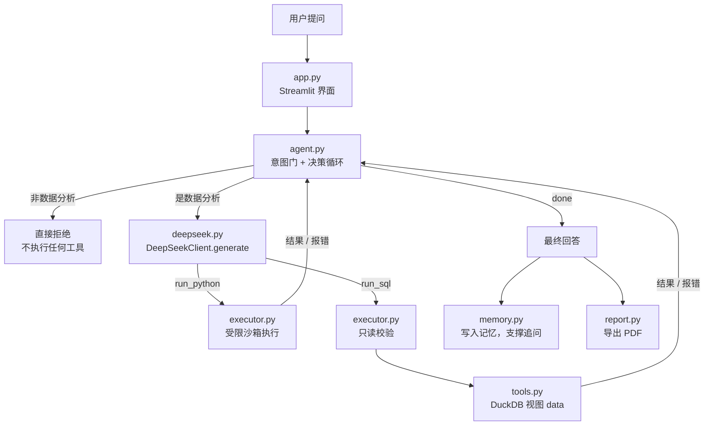
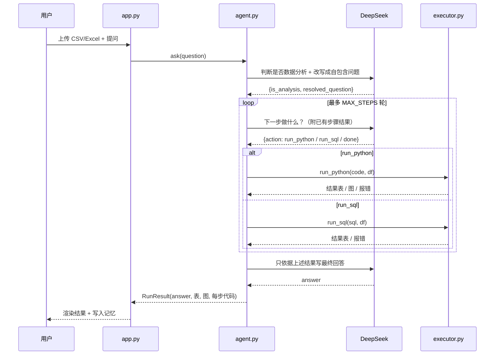

<div align="center">

# AI Data Analyst Agent

**上传数据 → 提问 → 它自己写 Python / SQL 算出真实结果**

一个基于 DeepSeek 的可执行数据分析 Agent：不是预设的"关键词 → 固定图表"，而是让模型自己写代码、真正跑、看结果、继续分析。

[](https://www.python.org/)
[](https://streamlit.io/)
[](https://platform.deepseek.com/)
[](LICENSE)
[](#贡献)

</div>

---

## 它解决什么问题

传统数据分析工具有个通病：用户只能点预设好的按钮，问法稍微偏一点就"没命中模板"，什么也得不到。

比如"哪些因素最影响用户复购"——这种问题没有固定 SQL 模板，必须真的算相关性、跑特征重要性、比较分布才能回答。

这个项目的做法是：**把"写代码"交给模型，把"执行"交给沙箱，把"结论"限定在真实结果里。**

```
你：哪些因素最影响用户复购？
Agent：→ 生成 Python（随机森林特征重要性 + 相关系数）
       → 在沙箱里真实执行
       → 拿到结果后决定补一张图
       → 只用这些数字写回答
```

**核心原则：模型不许编数字。** 所有数字必须来自工具的真实执行结果；拿不到就如实说拿不到。

---

## 功能

| 能力 | 说明 |
|---|---|
| 🧠 **自主规划** | 自己决定下一步：写 Python、跑 SQL、还是收尾回答，最多 `MAX_STEPS` 轮 |
| 🐍 **真实执行 Python** | pandas / numpy / scikit-learn / scipy / statsmodels / matplotlib，可做相关性、回归、特征重要性、聚类、统计检验、绘图 |
| 🗄️ **只读 SQL** | 上传的数据自动注册成 DuckDB 视图 `data`，支持 SELECT / WITH，写操作一律拒绝 |
| 🚫 **意图门** | 闲聊、写诗、翻译、代写代码等非数据请求直接拒绝，不消耗后续调用 |
| 💬 **多轮追问** | "只看一线城市呢""按渠道再看"——记忆会带上上一轮的实体与条件 |
| 🔍 **过程可审计** | 每一步生成的代码、是否报错、原始输出都展示在「分析详情」里，可复现 |
| 📄 **一键 PDF** | 数据描述 9 个章节 + 会话中的全部分析结论（含表和图） |
| 🔑 **Key 不落盘** | 在界面里填，只存在浏览器会话，不写日志、不进代码 |

---

## 它是怎么工作的



一次提问的完整时序：



几个关键取舍：

- **为什么让模型写代码，而不是堆模板？** 开放问题无法穷举，写代码的通用性远高于模板库。
- **为什么先做意图门？** 闲聊在提问里占比不低，先判一次能省掉后面所有执行与模型调用。
- **为什么坚持"数字只能来自工具"？** 这是数据分析可信度的底线。提示词约束 + 代码层不提供伪造通道。

---

## 快速开始

### 1. 环境要求

- Python 3.10 及以上
- 一个 DeepSeek API Key（[platform.deepseek.com](https://platform.deepseek.com/) → API Keys）

### 2. 安装

```bash
git clone https://github.com/<你的用户名>/<仓库名>.git
cd <仓库名>
pip install -r requirements.txt
```

国内网络慢可以加镜像：

```bash
pip install -r requirements.txt -i https://pypi.tuna.tsinghua.edu.cn/simple
```

### 3. 运行

```bash
streamlit run app.py
```

浏览器打开 `http://localhost:8501`。

### 4. 使用

1. 左侧填 DeepSeek API Key（也可以写进 `.env`，见下方配置）
2. 上传 CSV 或 Excel
3. 底部输入问题，回车
4. 结果区给出：文字结论 + 结果表 + 图表 + 「分析详情」（每步代码）
5. 需要正式材料时点 **Generate PDF Report** 下载报告

---

## 配置

| 变量 | 默认 | 说明 |
|---|---|---|
| `DEEPSEEK_API_KEY` | 空 | 界面里填也可以；写进 `.env` 只是省事 |
| `DEEPSEEK_MAX_STEPS` | `8` | 单次提问最多执行步数。调小更省钱，调大能做更深的分析 |

```bash
cp .env.example .env      # 然后把 DEEPSEEK_API_KEY= 后面填上你的 Key
```

> `.env` 已在 `.gitignore` 中，不会被提交。

---

## 目录结构

```text
.
├── app.py            # Streamlit 入口：上传、Key、提问、渲染、导出 PDF
├── agent.py          # Agent 主循环：意图门 → 决策 → 执行 → 回答 → 记忆
├── deepseek.py       # DeepSeek 客户端（唯一模型出口，含重试）
├── executor.py       # 执行层：run_python 沙箱 / run_sql 只读
├── prompts.py        # 4 个提示词：系统规则、意图判断、决策、最终回答
├── data_utils.py     # 文件读取 + 数据画像
├── tools.py          # SQL 只读校验 + DuckDB 执行
├── memory.py         # 会话历史 + 结构化分析上下文
├── report.py         # PDF 报告生成
├── requirements.txt
├── .env.example
└── data/  reports/   # 预留目录（程序不强制读写）
```

依赖方向单向、无循环导入：

```text
app.py → agent.py → executor.py → tools.py
                  → deepseek.py / prompts.py / memory.py
                  → report.py
```

---

## 能问什么

**适合的**

- 分组 / 排名 / 趋势：`各城市销售额排名`、`近 6 个月订单量趋势`
- 分布 / 异常：`消费金额分布如何，有异常值吗`、`找出偏离 3 个标准差的记录`
- 归因 / 相关性：`哪些因素最影响复购`、`价格和评分有关系吗`
- 统计建模：`做一次线性回归预测销售额，给出各变量系数`
- 可视化：`画一张各渠道复购率柱状图`

**会被拒绝的**

闲聊、写诗、翻译、通用知识问答、代写代码——它只分析你上传的那份数据。

**提问技巧**

1. 一次问一件事。
2. 把指标和维度说清楚：`按城市统计平均客单价` 好过 `看看数据`。
3. 结果不满意就继续追问：`换成随机森林再看一次重要性`。

---

## 安全边界（重要）

| 层 | 做法 | 现状 |
|---|---|---|
| SQL | `tools.validate_sql`：只放行 SELECT / WITH，剥离字面量与注释后再查关键字，拒绝多语句 | 只读，可靠 |
| Python | 白名单 import + 受限 builtins（禁 `open` / `eval` / `exec` / `compile` / `input` 等）+ 单线程 25 秒超时 | **进程内执行** |
| 密钥 | 只存在会话或本地 `.env`，不写入日志与代码 | 不落盘 |

`executor.run_python` 是**进程内 exec**，适合自己用或可信范围内使用。理论上仍可通过函数对象的 `__globals__` 绕过限制，超时后线程也无法强制终止。

**若要开放给不可信的外部用户，必须先把执行迁到子进程或容器（Docker）中隔离。** 这是当前唯一的架构级已知限制。

---

## 常见问题

| 现象 | 处理 |
|---|---|
| 提示"请先填写 API Key" | 左侧填完按回车确认 |
| 报"缺少依赖 openai" | `pip install openai` |
| 报"模型调用失败" | Key 失效 / 余额不足 / 网络；到平台确认额度 |
| CSV 读取失败 | 用 Excel 另存为 UTF-8 编码的 CSV 再传 |
| 分析很久没反应 | 把「最大分析步数」调到 3～4，或先抽样再分析 |
| 图表中文变方块 | 程序会自动查找系统里的雅黑 / 黑体；系统无中文字体时需自行安装 |
| 关掉终端后网页打不开 | 服务随终端结束，重新执行 `streamlit run app.py` |

---

## 路线图

- [ ] `run_python` 迁移到子进程 / Docker 隔离（面向多用户的前提）
- [ ] 补充自动化测试：沙箱逃逸、SQL 校验、Agent 循环
- [ ] 支持连接 MySQL（只读账号）作为数据源
- [ ] 相同问题的结果缓存，降低重复调用成本
- [ ] 图表样式可配置，PDF 增加页码与生成时间

---

## 贡献

欢迎提 Issue 和 PR。改动前建议先开 Issue 说明思路；提交前请确认：

- 不引入循环导入（依赖方向见上）
- 所有模型调用只走 `DeepSeekClient.generate()`
- 新增依赖同步更新 `requirements.txt`

## 许可证

[MIT](LICENSE)

## 致谢

- [DeepSeek](https://www.deepseek.com/) 提供模型能力
- [Streamlit](https://streamlit.io/) 提供界面框架
- [DuckDB](https://duckdb.org/) 提供进程内 SQL 引擎