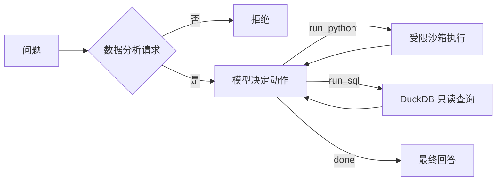

# AI Data Analyst Agent

上传 CSV 或 Excel，用中文提问，模型自己写 Python 或只读 SQL 在本地跑，再用跑出来的结果回答。

[](https://www.python.org/)
[](https://streamlit.io/)
[](LICENSE)

## 背景

常见的数据分析工具给的是一批固定按钮：柱状图、分组统计、Top N。真实需求很少正好落在这些按钮上。"哪些因素最影响用户复购"就没有对应按钮，得先算相关系数，再跑一遍特征重要性，还得比较不同人群的分布。

这个项目不预设分析步骤，让模型针对问题自己写代码。代码在本地执行，结果回传给模型，由它决定要不要继续算。回答里的数字只能来自这些执行结果。

## 功能

- 模型逐轮决定动作：写 Python、跑 SQL，或者收尾
- Python 侧可以 import pandas、numpy、scikit-learn、scipy、statsmodels、matplotlib
- SQL 侧用 DuckDB，上传的数据注册成表 `data`，只允许 SELECT 和 WITH
- 多轮追问时，上一轮筛过的城市、渠道会带进下一轮
- 每一步生成什么代码、有没有报错、输出了什么，界面上都能看到
- 可以导出 PDF，包含数据描述和本次会话的分析结果
- API Key 只存在浏览器会话里，不写日志

## 工作方式

问题进来先判一次：是不是针对当前数据集的提问。不是就直接回绝，不往下走。

确认是分析请求后进入循环。模型每轮只返回三种动作之一：`run_python`、`run_sql`、`done`。前两种交给 executor 执行，结果原样塞回下一轮提示词，最多 `MAX_STEPS` 轮。收到 `done` 后，用同一批结果写最终回答。



模型本身不产出数字，只产出代码。数字来自执行结果，写回答时也只允许引用结果里出现过的数值。

## 快速开始

需要 Python 3.10 以上，以及一个 DeepSeek API Key（在 platform.deepseek.com 创建）。

```bash
git clone https://github.com/fqqf11/ai-data-analyst-agent.git
cd ai-data-analyst-agent
pip install -r requirements.txt
streamlit run app.py
```

打开 http://localhost:8501，左侧填 Key，上传文件，然后在底部输入框提问。要出报告就点页面下方的 Generate PDF Report。

依赖装得慢可以换镜像：

```bash
pip install -r requirements.txt -i https://pypi.tuna.tsinghua.edu.cn/simple
```

## 配置

| 变量 | 默认 | 说明 |
|---|---|---|
| `DEEPSEEK_API_KEY` | 空 | 界面上填也行，写进 `.env` 只是省得每次填 |
| `DEEPSEEK_MAX_STEPS` | `8` | 一次提问最多执行多少步，调小省钱，调大能算得更深 |

`.env` 已在 `.gitignore` 里，不会被提交。

## 目录结构

```text
app.py          Streamlit 界面：上传、Key、提问、渲染、导出 PDF
agent.py        主循环：意图判断 → 决策 → 执行 → 回答 → 写记忆
deepseek.py     DeepSeek 客户端，全项目只从这里调模型
executor.py     执行层：run_python 沙箱、run_sql 只读
prompts.py      四个提示词：系统规则、意图判断、决策、最终回答
data_utils.py   读 CSV / Excel，生成数据画像
tools.py        SQL 只读校验 + DuckDB 执行
memory.py       会话历史和分析上下文
report.py       PDF 报告
data/           放数据的地方，程序不强制读写
reports/        生成的图表和报告
```

依赖是单向的：`app.py → agent.py → executor.py → tools.py`，`agent.py` 另外用到 `deepseek.py`、`prompts.py`、`memory.py`。

## 限制

- Python 代码在进程内执行。白名单 import、去掉 `open`/`eval`/`exec` 这类内置函数、25 秒超时，能挡住误操作，挡不住刻意构造的逃逸（比如通过函数对象的 `__globals__`）。自己用或者给可信的人用没问题，公开给陌生用户之前得换成子进程或容器隔离。
- SQL 只读。`validate_sql` 会先剥掉字符串字面量和注释，再检查关键字，写操作和多语句都会被拒。
- 结论准不准取决于模型写的代码对不对。好在结果表和执行记录都摊在界面上，能核对。
- 一次提问通常触发 2 到 10 次模型调用，步数调大费用跟着涨。
- 数据会复制进沙箱，建议控制在几十万行以内。

## 常见问题

- 提示缺 openai：`pip install openai`
- 模型调用失败：Key 失效、额度用完，或者网络不通
- CSV 读不出来：用 Excel 另存为 UTF-8 编码的 CSV 再试
- 等太久：把最大分析步数调到 3 到 4，或者先抽样
- 图表中文显示成方块：程序会自动找系统里的雅黑、黑体，系统没装中文字体就得自己装一个
- 关掉终端后网页打不开：服务跟着终端一起退出了，重新 `streamlit run app.py`

## 后续计划

- 把 `run_python` 挪到子进程或 Docker 里
- 补测试：沙箱、SQL 校验、Agent 循环
- 支持接 MySQL 只读账号

## License

MIT，见 [LICENSE](LICENSE)。